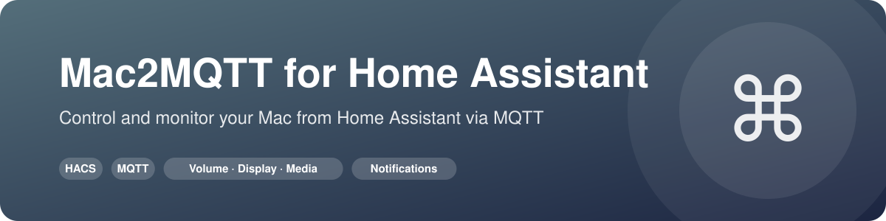
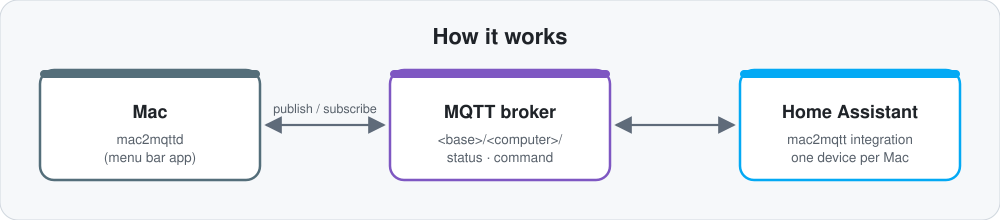
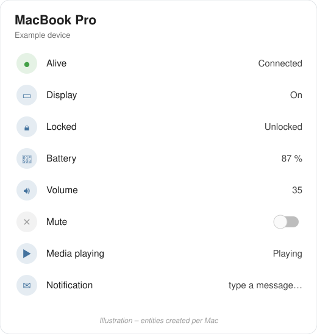
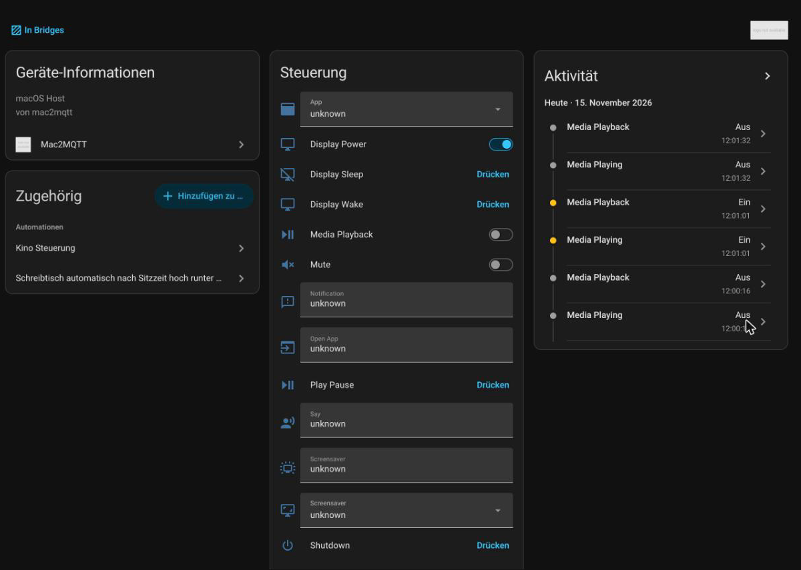

# Mac2MQTT HACS-Integration

[English](README.md) · **Deutsch**

[](https://hacs.xyz)



Home-Assistant-Integration für [`mac2mqtt` / `mac2mqttd`](https://github.com/dr-apple/mac2mqtt) – ein kleiner macOS-Dienst, der den Zustand deines Macs (Monitor, Sperre, Akku, Wiedergabe, Lautstärke) per MQTT veröffentlicht und Befehle annimmt (Ruhezustand, Sprachausgabe, Mitteilung, App öffnen …). Diese Integration macht aus den Topics ein richtiges Home-Assistant-Gerät mit Entitäten.

Version `0.12.1` ist mit Home Assistant `2026.8` kompatibel und gegen `2026.8.1` getestet. Die Entity-IDs bleiben stabil, wenn sich MQTT-Topic oder Computername ändern.



## Funktionen

- `binary_sensor`: Alive, Display, Locked, Media Playing
- `sensor`: Akku, Stromquelle, Zeitpunkt des letzten Monitorwechsels
- `select`: App, Bildschirmschoner
- `switch`: Stumm, Monitor, Wiedergabe
- `number`: Lautstärke (0–100)
- `button`: Ruhezustand, Ausschalten, Monitor aus, Monitor an, Bildschirmschoner starten, Play/Pause
- `text`: Sprachausgabe, Mitteilung, Bildschirmschoner, App öffnen



*Illustration – Entitäten eines Macs.*



*Echter Screenshot aus einer Home-Assistant-Installation (persönliche Daten ersetzt).*

## Voraussetzungen

- MQTT-Integration in Home Assistant eingerichtet und verbunden.
- [`mac2mqttd`](https://github.com/dr-apple/mac2mqtt) läuft auf dem Mac mit demselben Basis-Topic und Computernamen.

## Installation mit HACS

1. In Home Assistant: HACS → Integrationen → drei Punkte → Benutzerdefinierte Repositories.
2. `https://github.com/dr-apple/mac2mqtt-for-home-assistant` mit Kategorie `Integration` hinzufügen.
3. `Mac2MQTT` installieren.
4. Home Assistant neu starten.
5. Einstellungen → Geräte & Dienste → Integration hinzufügen → `Mac2MQTT`.
6. **Name**, **Computername** (`computerName` in `mac2mqtt.yaml`) und **Basis-Topic** (`topics.base`, Standard `mac2mqtt`) eingeben. Für jeden Mac wiederholen.

## MQTT-Topic-Zuordnung

Bei:

- `base_topic = mac2mqtt`
- `computer_name = my-macbook`

nutzt die Integration:

- Status (abonniert):
  - `mac2mqtt/my-macbook/status/alive`
  - `mac2mqtt/my-macbook/status/battery`
  - `mac2mqtt/my-macbook/status/power_source`
  - `mac2mqtt/my-macbook/status/display`
  - `mac2mqtt/my-macbook/status/display_changed_at`
  - `mac2mqtt/my-macbook/status/locked`
  - `mac2mqtt/my-macbook/status/media_playing`
  - `mac2mqtt/my-macbook/status/volume`
  - `mac2mqtt/my-macbook/status/mute`
- Befehle (veröffentlicht):
  - `mac2mqtt/my-macbook/command/volume`
  - `mac2mqtt/my-macbook/command/mute`
  - `mac2mqtt/my-macbook/command/sleep`
  - `mac2mqtt/my-macbook/command/shutdown`
  - `mac2mqtt/my-macbook/command/displaysleep`
  - `mac2mqtt/my-macbook/command/displaywake`
  - `mac2mqtt/my-macbook/command/display` (`sleep` / `wake`)
  - `mac2mqtt/my-macbook/command/say`
  - `mac2mqtt/my-macbook/command/notification` (text or JSON with `title` and `message`)
  - `mac2mqtt/my-macbook/command/screensaver` (saver name/path)
  - `mac2mqtt/my-macbook/command/app`
  - `mac2mqtt/my-macbook/command/media_playback` (`play` / `pause` / `toggle`)
  - `mac2mqtt/my-macbook/command/play_pause`

Auf Macs ohne internen Akku werden `status/battery` und `status/power_source` nicht veröffentlicht; vorhandene retained Werte löscht `mac2mqttd`.
Die Auswahl-Entitäten `App` und `Screensaver` veröffentlichen auf `command/app` bzw. `command/screensaver`. Ihre Optionslisten stammen aus der retained MQTT-Discovery-Konfiguration der Mac-App, sofern vorhanden.
Benachrichtigungen erscheinen als Dialog im Vordergrund auf dem Mac.
`command/say` pausiert laufende Wiedergabe vor der Sprachausgabe und setzt sie danach fort.

## Beispiele

**Monitor des Macs ausschalten, wenn du das Büro verlässt:**

```yaml
triggers:
  - trigger: state
    entity_id: person.ich
    from: home
actions:
  - action: button.press
    target:
      entity_id: button.macbook_pro_display_sleep
```

**Etwas auf dem Mac ansagen und als Dialog zeigen:**

```yaml
actions:
  - action: text.set_value
    target:
      entity_id: text.macbook_pro_say
    data:
      value: Die Waschmaschine ist fertig
  - action: text.set_value
    target:
      entity_id: text.macbook_pro_notification
    data:
      value: '{"title":"Wäsche","message":"Die Waschmaschine ist fertig"}'
```

**Licht dimmen, sobald der Mac Medien abspielt:** auf `binary_sensor.macbook_pro_media_playing` → `on` triggern.

Die Entity-IDs hängen vom eingegebenen Namen ab – siehe Geräteseite.

## Fehlersuche

| Problem | Lösung |
|---|---|
| Alle Entitäten nicht verfügbar | Läuft `mac2mqttd` (Menüleisten-App → *Start Service*)? Erscheint *Alive* im MQTT Explorer unter `<base>/<computer>/status/alive`? |
| Akku-Entitäten fehlen | Normal bei Macs ohne internen Akku. |
| App-/Bildschirmschoner-Liste leer | Die Listen kommen aus der retained Discovery-Konfiguration der Mac-App – Dienst einmal neu starten. |
