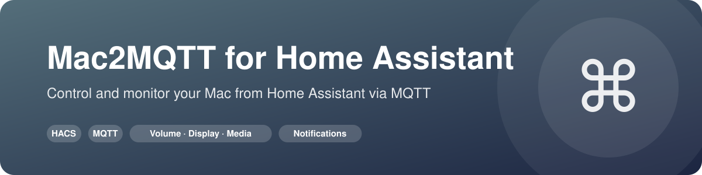
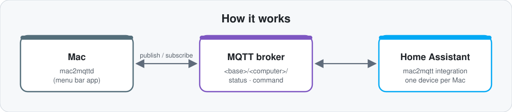
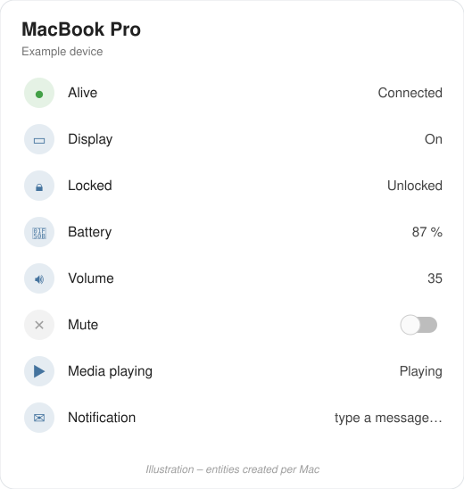
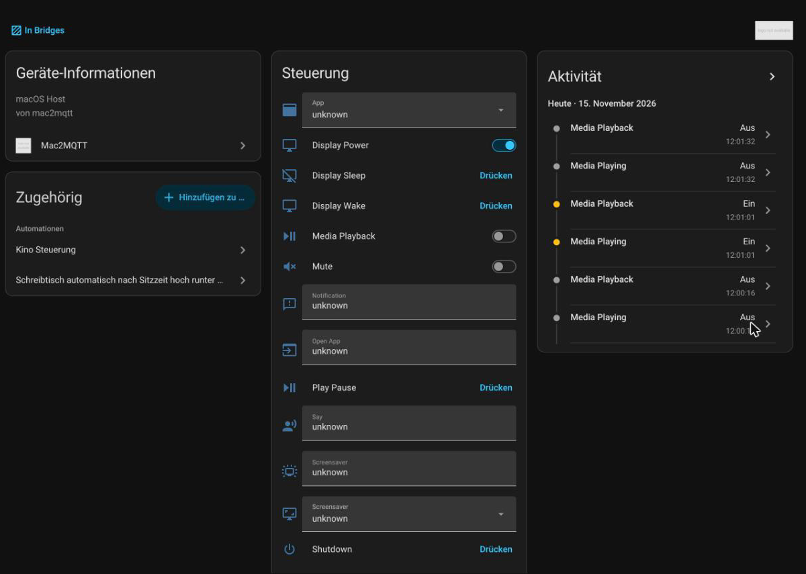

# Mac2MQTT HACS Integration

**English** · [Deutsch](README.de.md)

[](https://hacs.xyz)



Custom Home Assistant integration for [`mac2mqtt` / `mac2mqttd`](https://github.com/dr-apple/mac2mqtt) – a small macOS daemon that publishes the state of your Mac (display, lock, battery, media, volume) via MQTT and accepts commands (sleep, say, notification, open app …). This integration turns those topics into a proper Home Assistant device with entities.

Version `0.12.1` is compatible with Home Assistant `2026.8` and tested against `2026.8.1`. Entity IDs remain stable when the MQTT topic or computer name changes.



## Features

- `binary_sensor`: Alive, Display, Locked, Media Playing
- `sensor`: Battery, Power Source, Display Changed At
- `select`: App, Screensaver
- `switch`: Mute, Display Power, Media Playback
- `number`: Volume (0-100)
- `button`: Sleep, Shutdown, Display Sleep, Display Wake, Start Screensaver, Play Pause
- `text`: Say, Notification, Screensaver, Open App



*Illustration – entities created for one Mac.*



*Real screenshot from a Home Assistant installation (German UI, personal data replaced).*

## Requirements

- Home Assistant MQTT integration configured and connected.
- [`mac2mqttd`](https://github.com/dr-apple/mac2mqtt) running on your Mac with the same base topic and computer name.

## HACS install

1. In Home Assistant: HACS → Integrations → three dots → Custom repositories.
2. Add `https://github.com/dr-apple/mac2mqtt-for-home-assistant` and select category `Integration`.
3. Install `Mac2MQTT`.
4. Restart Home Assistant.
5. Settings → Devices & services → Add integration → `Mac2MQTT`.
6. Enter a **name**, the **computer name** (`computerName` in `mac2mqtt.yaml`) and the **base topic** (`topics.base`, default `mac2mqtt`). Repeat for every Mac.

## MQTT topic mapping

Given:

- `base_topic = mac2mqtt`
- `computer_name = my-macbook`

The integration uses:

- Status subscribe:
  - `mac2mqtt/my-macbook/status/alive`
  - `mac2mqtt/my-macbook/status/battery`
  - `mac2mqtt/my-macbook/status/power_source`
  - `mac2mqtt/my-macbook/status/display`
  - `mac2mqtt/my-macbook/status/display_changed_at`
  - `mac2mqtt/my-macbook/status/locked`
  - `mac2mqtt/my-macbook/status/media_playing`
  - `mac2mqtt/my-macbook/status/volume`
  - `mac2mqtt/my-macbook/status/mute`
- Command publish:
  - `mac2mqtt/my-macbook/command/volume`
  - `mac2mqtt/my-macbook/command/mute`
  - `mac2mqtt/my-macbook/command/sleep`
  - `mac2mqtt/my-macbook/command/shutdown`
  - `mac2mqtt/my-macbook/command/displaysleep`
  - `mac2mqtt/my-macbook/command/displaywake`
  - `mac2mqtt/my-macbook/command/display` (`sleep` / `wake`)
  - `mac2mqtt/my-macbook/command/say`
  - `mac2mqtt/my-macbook/command/notification` (text or JSON with `title` and `message`)
  - `mac2mqtt/my-macbook/command/screensaver` (saver name/path)
  - `mac2mqtt/my-macbook/command/app`
  - `mac2mqtt/my-macbook/command/media_playback` (`play` / `pause` / `toggle`)
  - `mac2mqtt/my-macbook/command/play_pause`

On Macs without an internal battery, `status/battery` and `status/power_source`
are not published and existing retained values are cleared by `mac2mqttd`.
The integration exposes native Mac2MQTT select entities for `App` and
`Screensaver` that publish to `command/app` and `command/screensaver`. Their
option lists are read from the Mac app's retained MQTT Discovery config when
available.
Notifications are shown as a frontmost dialog on the Mac.
`command/say` pauses active media playback before speaking and resumes it after
speech finishes.

## Examples

**Turn the Mac's display off when you leave the office:**

```yaml
triggers:
  - trigger: state
    entity_id: person.me
    from: home
actions:
  - action: button.press
    target:
      entity_id: button.macbook_pro_display_sleep
```

**Announce something on the Mac and show a dialog:**

```yaml
actions:
  - action: text.set_value
    target:
      entity_id: text.macbook_pro_say
    data:
      value: The washing machine is done
  - action: text.set_value
    target:
      entity_id: text.macbook_pro_notification
    data:
      value: '{"title":"Laundry","message":"The washing machine is done"}'
```

**Dim the lights when the Mac starts playing media:** trigger on `binary_sensor.macbook_pro_media_playing` turning `on`.

Entity IDs depend on the name you entered – check the device page.

## Troubleshooting

| Problem | Fix |
|---|---|
| All entities unavailable | Is `mac2mqttd` running (menu bar app → *Start Service*)? Does *Alive* show up in MQTT Explorer under `<base>/<computer>/status/alive`? |
| Battery entities missing | Normal on Macs without an internal battery. |
| App/Screensaver list empty | The lists come from the Mac app's retained discovery config – restart the service once. |
